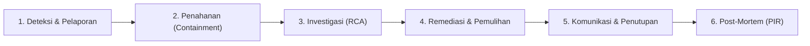

# PANDUAN PENANGANAN INSIDEN (INCIDENT RESPONSE PLAN)
## Finance Office MVP 1.0

---

## 1. Tujuan & Kebijakan Umum

Dokumen ini merupakan prosedur operasi standar tanggap darurat (*Emergency Incident Response Standard Operating Procedure*) bagi aplikasi **Finance Office MVP 1.0** untuk menangani kejadian yang mengancam:
1. **Keamanan & Kerahasiaan Data Finansial:** Mencegah kebocoran data sensitif, berkas nota kuitansi privat, nomor rekening, dan data pribadi karyawan.
2. **Ketepatan Kalkulasi Moneter:** Memastikan integritas saldo buku kas dan realisasi pagu anggaran selalu akurat tanpa toleransi penyimpangan.
3. **Ketersediaan Sistem Operasional:** Meminimalkan *downtime* operasional kantor dan memastikan pemulihan layanan berjalan cepat dan terukur.
4. **Kepatuhan Audit:** Memastikan seluruh kronologi investigasi dan tindakan korektif tercatat secara transparan dan tidak dapat dimanipulasi pada tabel audit log.

---

## 2. Matriks Klasifikasi Tingkat Keparahan Insiden (Severity Matrix - Point 15)

Setiap laporan anomali atau gangguan operasional wajib segera diklasifikasikan ke dalam 4 tingkatan keparahan berikut:

| Tingkat | Kategori | Kriteria Dampak pada Sistem Finance Office | Target Respons (SLA) | Target Resolusi |
|:---:|:---:|---|:---:|:---:|
| **P1** | **Kritis (Critical)** | - Seluruh aplikasi mati total (*total outage*).<br>- Kebocoran berkas lampiran privat atau data sensitif secara publik.<br>- Ketidaksesuaian/korupsi saldo kas berjalan secara sistemik.<br>- Serangan siber aktif (SQLi, RCE, bypass otorisasi global, manipulasi data transaksi). | **&le; 15 Menit** | **&le; 2 Jam** |
| **P2** | **Tinggi (High)** | - Alur persetujuan bertingkat terhenti (*approval freeze / deadlock*).<br>- Transaksi kas tidak dapat disimpan atau pagu anggaran gagal terpotong.<br>- Fitur ekspor laporan keuangan gagal total saat periode tutup buku.<br>- Akun pejabat (Manager/Director/Finance) terindikasi disusupi (*compromised*). | **&le; 30 Menit** | **&le; 4 Jam** |
| **P3** | **Sedang (Medium)** | - Penurunan performa responsif halaman laporan saat jam kerja padat.<br>- Notifikasi in-app terlambat diterima pengguna.<br>- Galat validasi non-kritis yang memiliki solusi sementara (*workaround*). | **&le; 2 Jam** | **&le; 24 Jam** |
| **P4** | **Rendah (Low)** | - Ketidaksesuaian tampilan minor / salah ketik label bahasa Indonesia.<br>- Kendala tata letak pada browser tertentu yang tidak menghalangi fungsi bisnis. | **&le; 4 Jam** | **&le; 72 Jam** |

---

## 3. Struktur Tim & Matriks Kontak Darurat (Siapa yang Dihubungi - Point 14)

### A. Struktur Tim Tanggap Insiden (Incident Response Team / IRT)

| Peran Tanggap Insiden | Anggota Penanggung Jawab | Tanggung Jawab Utama |
|---|---|---|
| **Incident Commander (IC)** | Lead DevOps / System Administrator | Mengoordinasikan seluruh respon teknis, memimpin penahanan, dan mengambil keputusan eskalasi. |
| **Technical Lead** | Senior Software Engineer | Menyelidiki akar masalah (*RCA*), menyusun hotfix kode, dan memverifikasi integritas database. |
| **Finance SME / Lead** | Kepala Bagian Keuangan (*Head of Finance*) | Memvalidasi integritas saldo riil kantor, merekonsiliasi kas bank, dan menyetujui tindakan korektif transaksi. |
| **Data Protection / Security Officer** | IT Security Lead | Menilai tingkat kebocoran data, melacak log forensik (`audit_logs`), dan memastikan kepatuhan regulasi UU PDP. |
| **Executive Sponsor** | Direktur Utama | Menyetujui tindakan penutupan darurat (*lockdown*), rilis komunikasi eksternal, dan menerima laporan final insiden. |

### B. Matriks Kontak Darurat & On-Call Roster

| Peran Tanggap Insiden | Nama / Posisi | Alamat Email | Telepon / Hotline Darurat |
|---|---|---|---|
| **Incident Commander** | DevOps On-Call | `ops-lead@office.test` | Ekstensi: 101 / +62-811-0000-001 |
| **Technical Lead** | Lead Backend Engineer | `tech-lead@office.test` | Ekstensi: 102 / +62-811-0000-002 |
| **Head of Finance** | Manager Keuangan | `finance-lead@office.test` | Ekstensi: 201 / +62-811-0000-003 |
| **Data Protection Officer** | Legal & Security Officer | `security@office.test` | Ekstensi: 202 / +62-811-0000-004 |
| **Direktur Utama** | Executive Sponsor | `director@office.test` | Ekstensi: 301 / +62-811-0000-005 |

*Kanal Komunikasi Insiden:* Channel Slack/Teams khusus `#incident-finance-war-room` (khusus penanganan insiden P1 & P2).

---

## 4. Siklus Hidup Penanganan Insiden (6 Tahapan Standar)



1. **Deteksi & Pelaporan:** Identifikasi indikasi insiden, klasifikasi keparahan (P1–P4), tunjuk IC.
2. **Penahanan (Containment):** Isolasi dampak, aktifkan maintenance mode jika perlu, bekukan akun/IP yang terindikasi.
3. **Investigasi (Root Cause Analysis):** Analisis jejak forensik pada `audit_logs`, `laravel.log`, dan Nginx access log.
4. **Remediasi & Pemulihan:** Terapkan hotfix teruji, jalankan transaksi rekonsiliasi kas (jika ada selisih), dan verifikasi *smoke test*.
5. **Komunikasi & Penutupan:** Berikan konfirmasi pemulihan sistem kepada pemangku kepentingan.
6. **Post-Mortem (PIR):** Evaluasi akar masalah dan tetapkan langkah pencegahan jangka panjang dalam waktu 48 jam.

---

## 5. Prosedur Penanganan Kasus Operasional Spesifik

---

### A. Cara Menangani Reimbursement Bermasalah (Point 9)

Reimbursement dapat mengalami kendala operasional dalam beberapa skenario berikut:

#### Skenario 1: Alur Persetujuan Terhenti (*Approval Deadlock / Manager Cuti*)
- **Penyebab:** Manager divisi yang berwenang sedang cuti sakit/dinas luar kota, sehingga klaim bawahan tertahan di status `waiting_manager_approval`.
- **Prosedur Penanganan:**
  1. Hubungi pemohon dan konfirmasi urgensi pembayaran reimbursement.
  2. Sesuai arsitektur sistem pada `ApprovalService::approve`, Direktur Utama memiliki hak otorisasi sah untuk bertindak sebagai approver pengganti tahap Manager (`$approver->isDirector()`).
  3. Direktur masuk ke sistem &rarr; buka detail pengajuan &rarr; klik tombol **Setujui** dengan memberikan catatan: *"Disetujui oleh Direktur atas nama delegasi pimpinan divisi"*.
  4. Pengajuan otomatis maju ke status `waiting_finance_verification` dan aksi tercatat transparan di `audit_logs`.

#### Skenario 2: Dokumen / Kuitansi Perlu Perbaikan (*Revision Required*)
- **Penyebab:** Bukti nota buram, rincian biaya tidak sesuai, atau nominal salah input oleh pemohon.
- **Prosedur Penanganan:**
  1. Approver (Manager atau Finance) **DILARANG** langsung menolak permanen jika hanya memerlukan nota pengganti.
  2. Approver memilih tombol **Kembalikan untuk Perbaikan** (`returnForRevision`).
  3. Masukkan catatan perbaikan wajib (misal: *"Nota nomor 2 buram, harap unggah ulang nota asli berstempel"*).
  4. Status pengajuan berubah menjadi `returned_for_revision`.
  5. Sistem otomatis mengirim notifikasi ke pemohon. Formulir pengajuan terbuka kembali untuk diedit (`reimbursements.edit`).
  6. Setelah pemohon memperbaiki data dan mengunggah ulang bukti, pemohon menekan **Kirim Ulang**. Alur persetujuan dimulai kembali.

#### Skenario 3: Penolakan Pengajuan Tidak Valid (*Rejection*)
- **Penyebab:** Klaim melanggar kebijakan pengeluaran kantor atau tidak dapat dipertanggungjawabkan.
- **Prosedur Penanganan:**
  1. Approver memilih opsi **Tolak Pengajuan** (`reject`).
  2. Masukkan alasan penolakan wajib pada dialog konfirmasi.
  3. Status pengajuan berubah permanen menjadi `rejected`. Dana tidak dicairkan dan kuota anggaran tetap utuh.

---

### B. Cara Menangani Pembayaran Ganda (Point 10)

#### Pencegahan Teknis di Sistem:
Aplikasi Finance Office secara arsitektural mencegah pembayaran ganda pada reimbursement melalui validasi `ApprovalService::markAsPaid`:
```php
if ($reimbursement->status !== ReimbursementStatus::APPROVED->value) {
    throw new \DomainException('Hanya reimbursement yang telah disetujui penuh (Approved) yang dapat dibayarkan.');
}
```
Jika reimbursement sudah berstatus `paid`, pemanggilan kedua akan melempar `DomainException` seketika di dalam database transaction atomik.

#### Penanganan Skenario Human Error (Transfer Bank Dobel / Transaksi Dobel Tercatat):
Jika staf Finance melakukan transfer bank 2x secara manual atau mencatat 2 transaksi pengeluaran identik di sistem:

1. **Investigasi Duplikasi pada Tabel Transaksi:**
   ```sql
   SELECT id, transaction_number, type, amount, category, payment_status, source_reference, created_at
   FROM transactions
   WHERE type = 'expense' AND amount = <NOMINAL> AND transaction_date = '<TANGGAL>'
   ORDER BY id ASC;
   ```

2. **Batalkan Transaksi Duplikat (DILARANG HARD DELETE):**
   - Transaksi yang merupakan salinan duplikat wajib dibatalkan melalui mekanisme resmi pembatalan (`TransactionService::cancelTransaction`):
     ```sql
     -- Atau melalui antarmuka web oleh Finance/Admin:
     -- Pilih Transaksi -> Klik "Batalkan Transaksi" -> Isi Alasan Pembatalan
     ```
   - Input alasan pembatalan wajib: `"Duplikasi pencatatan pembayaran transfer bank"`.
   - Status transaksi berubah menjadi `cancelled`.

3. **Pemulihan Alokasi Pagu Anggaran (Budget Restoration):**
   - Sistem secara otomatis memicu `BudgetService::releaseUsage` saat transaksi pengeluaran dibatalkan, sehingga pagu anggaran yang sempat terpotong dobel kembali utuh.

4. **Koreksi Saldo Otomatis:**
   - Karena kalkulasi saldo kas hanya menghitung transaksi aktif (`payment_status != 'cancelled'`), saldo kas buku sistem seketika kembali presisi.

5. **Penanganan Dana Riil di Rekening Bank:**
   - Hubungi penerima dana (karyawan/vendor) secara resmi untuk pengembalian dana lebih (*refund*).
   - Saat dana refund masuk ke rekening kantor, catat sebagai transaksi baru dengan tipe **Pemasukan (`income`)**, kategori `Pengembalian Kas Operasional`, dengan referensi ke transaksi awal.

---

### C. Cara Menangani Saldo Tidak Sesuai (Point 11)

#### Prinsip Sumber Kebenaran (*Single Source of Truth*):
Saldo kas kantor pada Finance Office dihitung secara dinamis dari mutasi transaksi aktif (`Transaction::active()`):
$$\text{Saldo Kas} = \sum(\text{Pemasukan Aktif}) - \sum(\text{Pengeluaran Aktif})$$
Transaksi dengan status `cancelled` secara otomatis dikecualikan dari kalkulasi.

#### Langkah-Langkah Investigasi & Rekonsiliasi:

1. **Bekukan Sementara Pencatatan Kas:**
   Minta seluruh staf Finance menghentikan pembuatan transaksi kas baru hingga rekonsiliasi selesai.

2. **Eksekusi Perhitungan Matematis Langsung di Database:**
   ```sql
   SELECT 
       COALESCE(SUM(CASE WHEN type = 'income' AND payment_status != 'cancelled' THEN amount ELSE 0 END), 0) AS total_pemasukan,
       COALESCE(SUM(CASE WHEN type = 'expense' AND payment_status != 'cancelled' THEN amount ELSE 0 END), 0) AS total_pengeluaran,
       COALESCE(SUM(CASE WHEN type = 'income' AND payment_status != 'cancelled' THEN amount ELSE 0 END), 0) -
       COALESCE(SUM(CASE WHEN type = 'expense' AND payment_status != 'cancelled' THEN amount ELSE 0 END), 0) AS saldo_buku_sistem
   FROM transactions;
   ```

3. **Bandingkan dengan Rekening Koran Bank (*Bank Statement*):**
   - Cari tanggal terjadinya deviasi (*gap day*):
     ```sql
     SELECT transaction_date, 
            SUM(CASE WHEN type = 'income' THEN amount ELSE 0 END) AS in_amount,
            SUM(CASE WHEN type = 'expense' THEN amount ELSE 0 END) AS out_amount
     FROM transactions
     WHERE payment_status != 'cancelled'
     GROUP BY transaction_date
     ORDER BY transaction_date DESC LIMIT 30;
     ```

4. **Tindakan Koreksi yang Sah:**
   - **Jika ada transaksi kas yang terlewat dicatat:** Buat transaksi baru dengan nominal dan tanggal sesuai bukti mutasi bank.
   - **Jika ada transaksi keliru/dobel:** Batalkan transaksi bersangkutan dengan alasan pembatalan wajib melalui `TransactionService::cancelTransaction`.
   - **DILARANG KERAS:** Mengubah nilai saldo secara langsung via manipulasi database tanpa melalui mutasi transaksi yang valid.

---

### D. Cara Menangani Berkas Bukti yang Tidak Dapat Diakses (Point 12)

#### Skenario 1: Error 403 Forbidden saat Membuka Bukti Lampiran
- **Akar Masalah:** Pelanggaran otorisasi server-side.
- **Investigasi:**
  Kebijakan `ReimbursementPolicy::viewAttachment` membatasi akses lampiran hanya untuk:
  1. Pemilik klaim (Employee yang mengajukan).
  2. Manager dari divisi yang sama dengan pemohon.
  3. Staf Finance atau Direktur.
- **Tindakan:**
  - Periksa divisi pengguna pemohon dan divisi pengguna yang mencoba mengakses:
    ```sql
    SELECT id, name, role, department FROM users WHERE id = <USER_ID>;
    SELECT id, number, user_id, department, attachment_path FROM reimbursements WHERE id = <REIMBURSEMENT_ID>;
    ```
  - Jika pengguna memang berhak (misal baru mutasi divisi), lakukan pembaruan data departemen pengguna oleh Administrator.

#### Skenario 2: Error 404 Not Found (Berkas Fisik Tidak Ditemukan di Storage)
- **Akar Masalah:** Path berkas di database tidak ditemukan pada direktori penyimpanan fisik server.
- **Investigasi:**
  1. Dapatkan path relatif dari basis data:
     ```sql
     SELECT id, number, attachment_path FROM reimbursements WHERE id = <REIMBURSEMENT_ID>;
     ```
  2. Periksa keberadaan fisik berkas di server:
     ```bash
     ls -l /var/www/finance-office/storage/app/<ATTACHMENT_PATH>
     ```
  3. Periksa hak akses dan kepemilikan direktori:
     ```bash
     chown -R www-data:www-data /var/www/finance-office/storage/app/reimbursements
     chmod -R 775 /var/www/finance-office/storage/app/reimbursements
     ```
- **Tindakan Pemulihan:**
  - Pulihkan berkas dari arsip backup storage harian terbaru:
    ```bash
    tar -xzf /var/backups/finance_office/storage_YYYYMMDD_HHMMSS.tar.gz -C /var/www/finance-office/storage/app/ <ATTACHMENT_PATH>
    ```
  - Jika berkas belum sempat ter-backup (baru diunggah): Gunakan alur `returnForRevision` agar pemohon mengunggah ulang dokumen lampiran nota.

---

### E. Cara Menangani Kebocoran Data (Data Breach - Point 13)

Jika terdeteksi bahwa data transaksi, bukti nota privat, atau nomor rekening karyawan terekspos secara publik:

#### 1. Penahanan Cepat (*Immediate Containment - &le; 15 Menit*):
- **Aktifkan Mode Pemeliharaan Darurat:**
  ```bash
  cd /var/www/finance-office
  php artisan down --secret="emergency-data-breach-response" --render="errors::503"
  ```
- **Periksa & Pastikan Tidak Ada Public Symbolic Link:**
  Pastikan nota kuitansi tidak dapat dijangkau dari web root publik:
  ```bash
  rm -f /var/www/finance-office/public/storage/reimbursements
  rm -f /var/www/finance-office/public/storage/transactions
  ```
- **Blokir IP Penyerang pada Firewall:**
  ```bash
  ufw insert 1 deny from <IP_PENYERANG> to any
  ```

#### 2. Rotasi Kredensial Kunci (*Credential Invalidation*):
- Ganti kredensial database pada `.env` dan MySQL server.
- Generate ulang `APP_KEY` jika konfigurasi server dicurigai bocor:
  ```bash
  php artisan key:generate
  ```
- Reset kata sandi seluruh akun pengguna berkategori Admin, Finance, dan Direktur.
- Musnahkan seluruh sesi aktif pengguna:
  ```bash
  rm -f /var/www/finance-office/storage/framework/sessions/*
  ```

#### 3. Investigasi Forensik & Penentuan Dampak:
- Telusuri berkas yang sempat diakses menggunakan Nginx access log:
  ```bash
  grep "reimbursements" /var/log/nginx/access.log | grep " 200 " > /var/log/breach_investigation.log
  ```
- Periksa tabel `audit_logs` untuk mencatat identitas akun dan rentang waktu paparan (*exposure window*).

#### 4. Kepatuhan Regulasi & Pemberitahuan (UU Perlindungan Data Pribadi):
- Susun laporan komprehensif bersama Data Protection Officer (DPO).
- Sampaikan pemberitahuan resmi kepada Direktur Utama dan pemangku kepentingan terdampak dalam waktu maksimal $3 \times 24$ jam.

---

## 6. Prosedur Rollback & Audit Selama Penanganan Insiden

- **Prosedur Rollback Sistem:** Bila insiden dipicu oleh rilis versi kode atau migrasi baru yang bermasalah, ikuti panduan rollback terinci pada [Panduan Operasional Sistem (Operations Runbook) Bab 10](file:///d:/laragon/www/Finansial%20Office/docs/operations-runbook.md#10-prosedur-rollback-versi-rilis--database-point-16).
- **Prosedur Audit Insiden:** Seluruh tindakan korektif dan investigasi wajib dicocokkan dengan jejak rekaman append-only pada [Panduan Operasional Sistem Bab 11](file:///d:/laragon/www/Finansial%20Office/docs/operations-runbook.md#11-prosedur-audit-sistem--transaksi-point-17).

---

## 7. Formulir Laporan Pasca-Insiden (Post-Incident Review / PIR Template)

Dokumentasikan setiap insiden P1 dan P2 menggunakan format evaluasi berikut:

```markdown
# POST-INCIDENT REVIEW (PIR) REPORT

- **Nomor Laporan:** PIR-2026-[NOMOR]
- **Tingkat Keparahan:** [P1 / P2]
- **Modul Terdampak:** [Auth / Reimbursement / Transaksi / Anggaran / Laporan / Storage]
- **Waktu Terdeteksi:** [YYYY-MM-DD HH:mm WIB]
- **Waktu Selesai (Pulih):** [YYYY-MM-DD HH:mm WIB]
- **Total Durasi Insiden:** [X Jam Y Menit]
- **Incident Commander:** [Nama Lengkap]

### 1. Ringkasan Insiden
[Penjelasan singkat 1-2 paragraf mengenai kejadian dan dampaknya terhadap operasional kantor]

### 2. Kronologi Kejadian (Timeline)
- **HH:mm WIB** — Anomali terdeteksi pertama kali melalui [alert / laporan user].
- **HH:mm WIB** — Incident Commander menetapkan severity P[X] dan mengaktifkan tim tanggap darurat.
- **HH:mm WIB** — Tindakan penahanan (containment) diterapkan (misal: maintenance mode).
- **HH:mm WIB** — Akar masalah (RCA) berhasil diidentifikasi.
- **HH:mm WIB** — Tindakan perbaikan/hotfix diterapkan dan diverifikasi.
- **HH:mm WIB** — Layanan dipulihkan penuh dan insiden resmi ditutup.

### 3. Akar Masalah (Root Cause Analysis - 5 Whys)
[Uraian mendalam faktor penyebab paling mendasar dari insiden]

### 4. Dampak Finansial & Operasional
- Data Saldo Terpengaruh: [Ya / Tidak] (Jika Ya, lampirkan nomor transaksi koreksi)
- Kerahasiaan Berkas: [Aman / Terisolasi]
- Jumlah Pengguna Terdampak: [X Orang]

### 5. Rencana Tindakan Pencegahan (Action Items)
| No | Tindakan Korektif | Penanggung Jawab | Target Selesai | Status |
|:---:|---|---|:---:|:---:|
| 1 | [Tindakan pencegahan teknis] | [Nama] | [Tanggal] | Open |
| 2 | [Pembaruan kebijakan / SOP] | [Nama] | [Tanggal] | Open |
```
